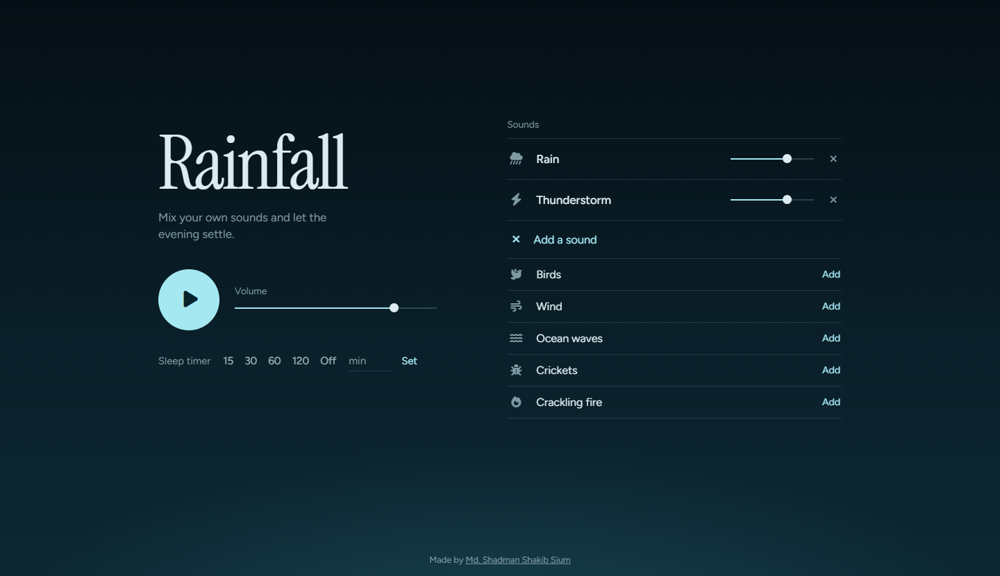

# 🌧️ Rainfall

Mix your own calming sounds — rain, thunder, birds, wind, ocean waves, crickets and a crackling fire — set a sleep timer, and let the evening settle.

**Live demo:** [Rainfall](https://rainfallsound.netlify.app/)


<!-- Take a screenshot, save it as docs/screenshot.png -->

## Features

- Mix any number of sounds, each with its own volume slider
- Sleep timer (15 / 30 / 60 / 120 min or custom) with a gentle fade-out
- Rain ripples on the screen react to the rain volume
- Installable PWA — works like a native app on phone and desktop
- Remembers your mix (saved in your browser only)
- No frameworks, no build step, no tracking

## Add your sounds

Put audio files inside `sounds/<category>/` and number them `1`, `2`, `3`… (`.mp3`, `.wav`, `.ogg` or `.m4a`).

```
sounds/
├─ rain/      1.mp3  2.mp3 ...
├─ thunder/   1.mp3 ...
├─ birds/
├─ wind/
├─ waves/
├─ crickets/
└─ fire/
```

If a category has several files, one is picked at random each time. Only use sounds you own or that have a licence allowing reuse.

## Run locally

```bash
git clone https://github.com/shadmanshakibsium/rainfall.git
cd rainfall
python3 -m http.server 8000   # then open http://localhost:8000
```

(Open it through a local server, not by double-clicking — the service worker needs `http://`.)

## Deploy on GitHub Pages

1. Push this repo to GitHub
2. **Settings → Pages → Build and deployment**
3. Source: **Deploy from a branch** → `main` → `/ (root)` → Save
4. After a minute your site is live at `https://YOUR-USERNAME.github.io/rainfall/`

## Customise

| What | Where |
| --- | --- |
| Sound categories & icons | `CATS` in `index.html` |
| App name, colours | `manifest.webmanifest` |
| Icons / favicon | `icons/` |
| Offline cache version | `VERSION` in `sw.js` (bump after each update) |

## About me

Hi, I'm **Md. Shadman Shakib  Sium** 👋

I'm a [student / developer] from Bangladesh 🇧🇩. I like building small, simple and beautiful web things.
Rainfall started because I wanted calm rain sounds to fall asleep to — without ads or subscriptions.

- 🌐 Website: [https://aboutshadman.netlify.app](https://aboutshadman.netlify.app/)
- 🐙 GitHub: [ShadmanShakibSium](https://github.com/shadmanshakibsium)
- ✉️ Email: mdshadmanshakibsium@gmail.com

If you like this project, please give it a ⭐ — it really helps!

## Credits

- Fonts: [Figtree](https://fonts.google.com/specimen/Figtree) and [Instrument Serif](https://fonts.google.com/specimen/Instrument+Serif) (Google Fonts, OFL)
- Icons: [Font Awesome Free](https://fontawesome.com) (CC BY 4.0 / SIL OFL)
- Sounds: [pixabay](https://pixabay.com/sound-effects/)
## License

Code is released under the [MIT License](LICENSE). Audio files in `sounds/` keep their own licences.
